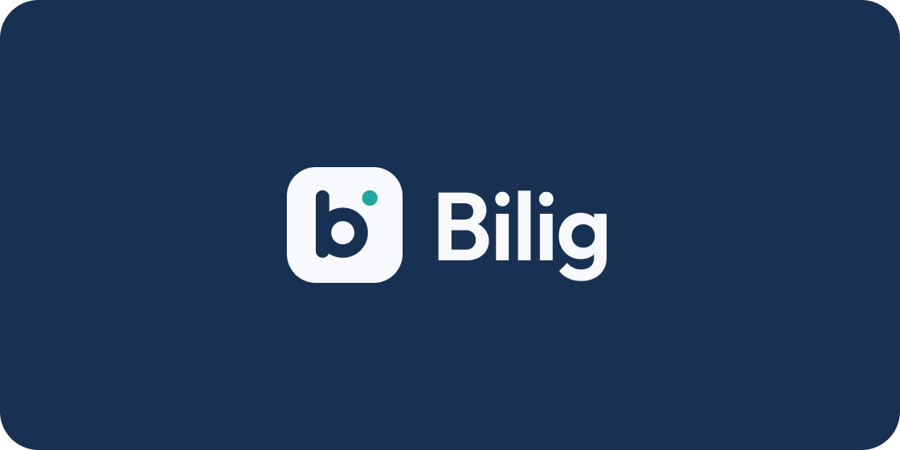

<p align="center">
  
</p>

# Hata Analizi Asistanı

Öğrencinin test sorularındaki yanlışlarını kazanım bazında analiz eder, konuyu ders kitabından alıntıyla anlatır ve aynı kazanımdan benzer soru üretir.

## Nasıl çalışır

1. Öğrenci bir test çözer. Yarıda bırakırsa kaldığı yerden devam eder.
2. Yanlış yaptığında sistem sorunun hangi kazanıma ait olduğunu kaydeder.
3. Yapay zeka konuyu anlatır. Anlatımın altında ders kitabındaki ilgili paragraf ve sayfa görünür.
4. Öğrenci aynı kazanımdan yeni bir soru çözer. Takılırsa ipucu açar.
5. Panelde kazanım bazlı başarı ve hata türleri görünür.

Yönetici, ders kitabı ve soru PDF'lerini yükler. Sistem bunları işler, bir inceleme ekranında yöneticiye gösterir ve onaylananları bilgi tabanına ekler.

## Servisler

| Servis | Teknoloji | Görevi |
| --- | --- | --- |
| `apps/web` | React, Vite, TypeScript | Sadece gösterir; iş kuralı içermez. |
| `services/core` | Java, Spring Boot | Giriş, test, cevap, ilerleme, limit ve yetki kurallarının sahibidir. Tabloları oluşturur. |
| `services/ai` | Python, FastAPI | Claude çağrıları, embedding, arama ve PDF hazırlık hattı. `ai-worker` aynı imajla iş kuyruğunu çalıştırır. |
| `postgres` | PostgreSQL, pgvector, pg_textsearch | Veri ve arama indeksi. |

Tarayıcı sadece `core` servisine konuşur. `core`, yapay zeka işleri için `ai` servisinin iç uç noktalarını çağırır.

## Kurulum

Gerekenler: Docker Desktop, Git. Yapay zeka servisleri NVIDIA ekran kartı ister. Kartı olmayan makinede ai servislerini yerelde `uv run` ile başlat.

```bash
cp .env.example .env
docker compose up --build
```

`.env` içindeki `ANTHROPIC_API_KEY` değerini doldur. Uygulama `http://localhost:8080` adresinde açılır.

Modelleri bir kez indirmek için:

```bash
docker compose run --rm -e HF_HUB_OFFLINE=0 ai-api python -m scripts.download_models
```

## Geliştirme

| Servis | Komut |
| --- | --- |
| Java | `cd services/core && ./mvnw spotless:apply verify` |
| Python | `cd services/ai && uv run ruff format . && uv run ruff check . && uv run mypy app && uv run pytest` |
| Web | `cd apps/web && npm run lint && npm run typecheck && npm test` |

Ortak kurallar [AGENTS.md](AGENTS.md) dosyasındadır. Ekip planı [Hata Analizi Asistanı.md](Hata%20Analizi%20Asistanı.md) dosyasındadır.

## Lisans

Bu proje [GNU Affero Genel Kamu Lisansı v3.0](LICENSE) (AGPL-3.0) ile lisanslıdır.

- **Kişisel ve açık kaynak kullanım:** AGPL-3.0 şartlarına uyarak ücretsiz kullanabilir, değiştirebilir ve dağıtabilirsin. Değiştirdiğin sürümü ağ üzerinden hizmet olarak sunuyorsan kaynak kodunu kullanıcılarına vermek zorundasın.
- **Ticari kullanım:** Kaynak kodunu açmadan ya da AGPL şartları dışında kullanmak isteyen kişi ve kurumlar, proje sahibinden ayrı bir ticari lisans almalıdır.

Ticari lisans için proje sahibiyle GitHub üzerinden iletişime geç: [Boran-Sert](https://github.com/Boran-Sert).

Telif hakkı © 2026 Boran Sert.
