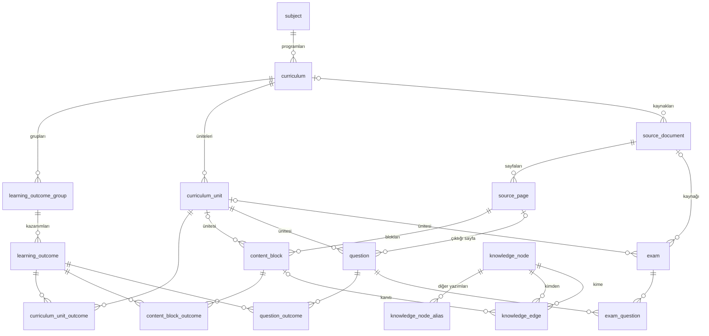
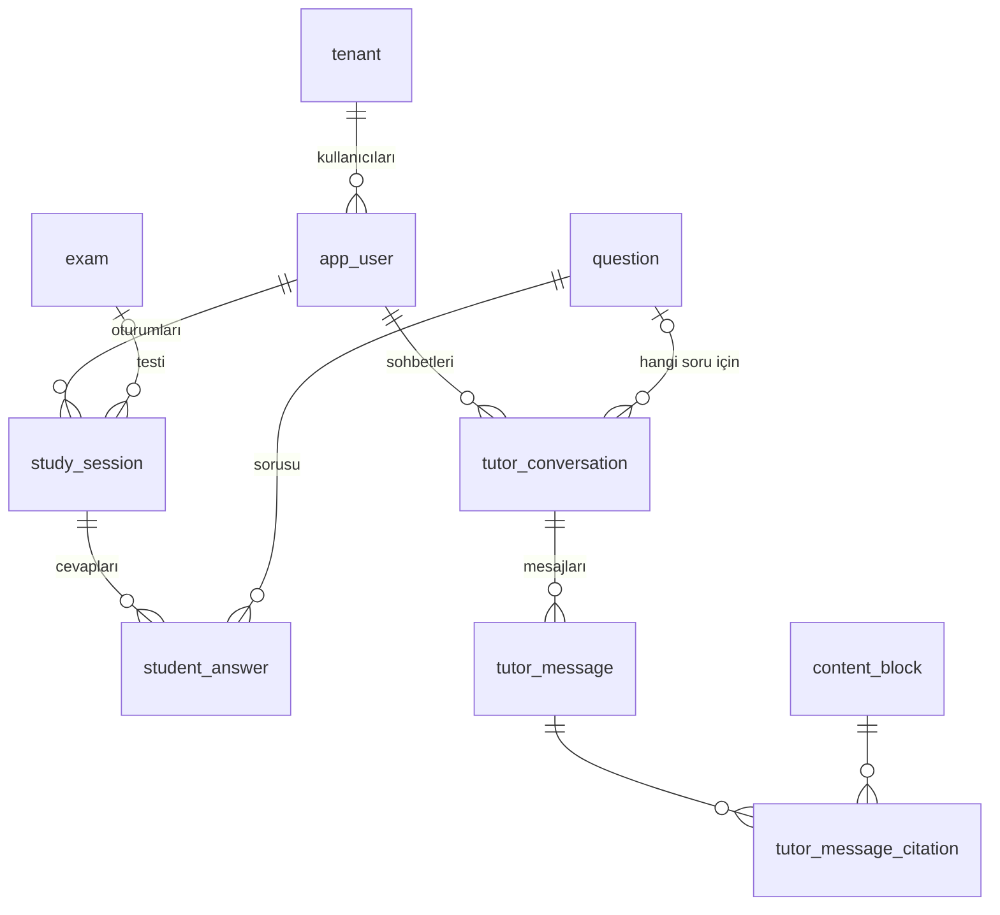
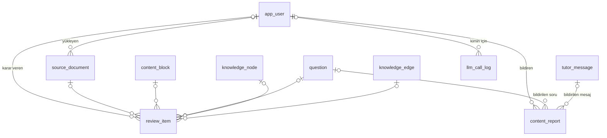

# Hata Analizi Asistanı · Veritabanı Şeması

PostgreSQL 18 + pgvector + pg_textsearch. Şemayı sadece Java servisi Flyway ile oluşturur.

**Ortak kurallar**
- Her tabloda `id bigint generated always as identity` birincil anahtardır (ara tablolar hariç; onlarda iki kolonlu birincil anahtar var).
- Her tabloda `created_at timestamptz not null default now()`; güncellenen tablolarda `updated_at`.
- Sabit değer kümeleri `text` + `CHECK`, değerler büyük harf.
- Vektörler `vector(1024)` (bge-m3), HNSW index ve `vector_cosine_ops` ile.
- Kelime araması `search_text` kolonunda, BM25 index'iyle (`pg_textsearch`, `text_config='turkish'`).
- Yabancı anahtar adı `<tablo>_id`, index adı `idx_<tablo>_<kolon>`, tekillik `uq_...`.

29 tablo, 5 katman: **Program** (6) · **İçerik** (8) · **Bilgi** (3) · **Öğrenci** (8) · **İşletim** (4).

---

## 1. İlişki diyagramları

### Program, içerik ve bilgi katmanı

### Öğrenci katmanı

### İşletim katmanı

`background_job` tablosunun yabancı anahtarı yok; hangi kayıtla ilgili olduğu `payload` içinde durur.

**Okuma:** `||--o{` bire çok, `|o--o{` boş olabilen bire çok demek. Çoka-çok ilişkiler ara tabloyla kurulur: `curriculum_unit_outcome`, `content_block_outcome`, `question_outcome`, `exam_question`, `tutor_message_citation`.

---

## 2. Program katmanı

### `subject` · Ders

| Kolon | Tip | Boş | Varsayılan | Kısıt |
|---|---|---|---|---|
| id | bigint | hayır | identity | PK |
| code | text | hayır | | UNIQUE · örnek `TDE` |
| name | text | hayır | | Türk Dili ve Edebiyatı |
| created_at | timestamptz | hayır | now() | |

### `curriculum` · Öğretim programı sürümü

| Kolon | Tip | Boş | Varsayılan | Kısıt |
|---|---|---|---|---|
| id | bigint | hayır | identity | PK |
| subject_id | bigint | hayır | | FK → subject(id) |
| name | text | hayır | | örnek "TDE Öğretim Programı 2018" |
| model | text | hayır | | CHECK IN ('LEGACY', 'MAARIF') |
| year | smallint | hayır | | |
| created_at | timestamptz | hayır | now() | |

- `uq_curriculum_subject_id_name` UNIQUE (subject_id, name)

### `learning_outcome_group` · Kazanım grubu

| Kolon | Tip | Boş | Varsayılan | Kısıt |
|---|---|---|---|---|
| id | bigint | hayır | identity | PK |
| curriculum_id | bigint | hayır | | FK → curriculum(id) |
| code | text | hayır | | örnek `A.2` |
| name | text | hayır | | örnek "Öyküleyici metinler" |
| created_at | timestamptz | hayır | now() | |

- `uq_learning_outcome_group_curriculum_id_code` UNIQUE (curriculum_id, code)

### `learning_outcome` · Kazanım

| Kolon | Tip | Boş | Varsayılan | Kısıt |
|---|---|---|---|---|
| id | bigint | hayır | identity | PK |
| learning_outcome_group_id | bigint | hayır | | FK → learning_outcome_group(id) |
| code | text | hayır | | örnek `A.2.7` |
| title | text | hayır | | "Metindeki zaman ve mekânın özelliklerini belirler." |
| meb_explanation | text | evet | | Kazanımın altındaki MEB açıklaması |
| search_text | text | hayır | | Yol + başlık + açıklama |
| embedding | vector(1024) | evet | | |
| created_at | timestamptz | hayır | now() | |

- `uq_learning_outcome_group_id_code` UNIQUE (learning_outcome_group_id, code)
- `idx_learning_outcome_embedding` HNSW (embedding vector_cosine_ops)
- `idx_learning_outcome_bm25` BM25 (search_text)

### `curriculum_unit` · Ünite

| Kolon | Tip | Boş | Varsayılan | Kısıt |
|---|---|---|---|---|
| id | bigint | hayır | identity | PK |
| curriculum_id | bigint | hayır | | FK → curriculum(id) |
| grade | smallint | hayır | | CHECK (grade BETWEEN 9 AND 12) |
| unit_no | smallint | hayır | | |
| title | text | hayır | | örnek "Roman" |
| created_at | timestamptz | hayır | now() | |

- `uq_curriculum_unit_curriculum_id_grade_unit_no` UNIQUE (curriculum_id, grade, unit_no)

### `curriculum_unit_outcome` · Hangi ünitede hangi kazanım işlenir

| Kolon | Tip | Boş | Varsayılan | Kısıt |
|---|---|---|---|---|
| curriculum_unit_id | bigint | hayır | | PK · FK → curriculum_unit(id) |
| learning_outcome_id | bigint | hayır | | PK · FK → learning_outcome(id) |

---

## 3. İçerik katmanı

### `source_document` · Yüklenen dosya

| Kolon | Tip | Boş | Varsayılan | Kısıt |
|---|---|---|---|---|
| id | bigint | hayır | identity | PK |
| curriculum_id | bigint | evet | | FK → curriculum(id) |
| kind | text | hayır | 'UNKNOWN' | CHECK IN ('UNKNOWN', 'PROGRAM', 'TEXTBOOK', 'TEST', 'QUESTION_BANK', 'ANSWER_KEY') · yüklemede bilinmez, Python tahmin eder |
| title | text | hayır | | |
| publisher | text | evet | | |
| year | smallint | evet | | |
| grade | smallint | evet | | |
| sha256 | char(64) | hayır | | UNIQUE · aynı dosya iki kez girmez |
| file_path | text | hayır | | `/data/sources/{id}.pdf` |
| text_layer_valid | boolean | evet | | Metin katmanı kontrolünün sonucu |
| profile_name | text | evet | | `profiles/*.yaml` dosyasının adı |
| license_status | text | hayır | 'UNKNOWN' | CHECK IN ('MEB', 'PERMITTED', 'UNKNOWN') |
| status | text | hayır | 'UPLOADED' | CHECK IN ('UPLOADED', 'PROCESSING', 'REVIEW', 'PUBLISHED', 'FAILED') |
| uploaded_by | bigint | hayır | | FK → app_user(id) |
| created_at | timestamptz | hayır | now() | |
| updated_at | timestamptz | hayır | now() | |

### `source_page` · Sayfa

| Kolon | Tip | Boş | Varsayılan | Kısıt |
|---|---|---|---|---|
| id | bigint | hayır | identity | PK |
| source_document_id | bigint | hayır | | FK → source_document(id) ON DELETE CASCADE |
| page_no | integer | hayır | | |
| image_path | text | evet | | `/data/pages/{source_id}/{page_no}.png` |
| created_at | timestamptz | hayır | now() | |

- `uq_source_page_source_document_id_page_no` UNIQUE (source_document_id, page_no)

### `content_block` · Konu anlatımı paragrafı

| Kolon | Tip | Boş | Varsayılan | Kısıt |
|---|---|---|---|---|
| id | bigint | hayır | identity | PK |
| source_page_id | bigint | hayır | | FK → source_page(id) ON DELETE CASCADE |
| curriculum_unit_id | bigint | evet | | FK → curriculum_unit(id) |
| block_type | text | hayır | | CHECK IN ('BILGI', 'ALINTI', 'ETKINLIK', 'METIN', 'BASLIK') |
| position | integer | hayır | | Sayfa içindeki sıra |
| title_path | text | hayır | | "TDE 12 Ders Kitabı › Roman › Roman Türleri" |
| markdown | text | hayır | | Paragrafın kendisi (markdown) |
| confidence | real | evet | | Ayrıştırma güveni, 0–1 |
| status | text | hayır | 'DRAFT' | CHECK IN ('DRAFT', 'REVIEW', 'PUBLISHED', 'REJECTED') |
| search_text | text | hayır | | title_path + markdown |
| embedding | vector(1024) | evet | | |
| created_at | timestamptz | hayır | now() | |
| updated_at | timestamptz | hayır | now() | |

- `uq_content_block_source_page_id_position` UNIQUE (source_page_id, position)
- `idx_content_block_embedding` HNSW (embedding vector_cosine_ops)
- `idx_content_block_bm25` BM25 (search_text)

Alıntı kartındaki "TDE 12 Ders Kitabı · s. 174" bilgisi saklanmaz; `source_document.title` ve `source_page.page_no`'dan üretilir.

### `content_block_outcome` · Paragraf ↔ kazanım

| Kolon | Tip | Boş | Varsayılan | Kısıt |
|---|---|---|---|---|
| content_block_id | bigint | hayır | | PK · FK → content_block(id) ON DELETE CASCADE |
| learning_outcome_id | bigint | hayır | | PK · FK → learning_outcome(id) |
| mapped_by | text | hayır | | CHECK IN ('MODEL', 'HUMAN', 'SOURCE') |
| created_at | timestamptz | hayır | now() | |

- `idx_content_block_outcome_learning_outcome_id` (learning_outcome_id)

### `question` · Soru

| Kolon | Tip | Boş | Varsayılan | Kısıt |
|---|---|---|---|---|
| id | bigint | hayır | identity | PK |
| source_page_id | bigint | evet | | FK → source_page(id) · üretilen soruda boş |
| curriculum_unit_id | bigint | hayır | | FK → curriculum_unit(id) |
| origin | text | hayır | | CHECK IN ('SOURCE', 'GENERATED') |
| content | jsonb | hayır | | Kök, ortak parça ve şıklar (plan 13.6) |
| correct_option | char(1) | hayır | | CHECK IN ('A', 'B', 'C', 'D', 'E') |
| hint | text | evet | | İlk istekte üretilip saklanır |
| difficulty | smallint | evet | | CHECK (difficulty BETWEEN 1 AND 5) |
| status | text | hayır | 'DRAFT' | CHECK IN ('DRAFT', 'REVIEW', 'PUBLISHED', 'REJECTED') |
| content_hash | char(64) | hayır | | UNIQUE · aynı soru iki kez girmez |
| embedding | vector(1024) | evet | | |
| created_at | timestamptz | hayır | now() | |
| updated_at | timestamptz | hayır | now() | |

- `idx_question_curriculum_unit_id_status` (curriculum_unit_id, status)
- `idx_question_embedding` HNSW (embedding vector_cosine_ops)

Sorunun kazanım kolonu yoktur; kazanımlar `question_outcome`'da.

### `question_outcome` · Soru ↔ kazanım

| Kolon | Tip | Boş | Varsayılan | Kısıt |
|---|---|---|---|---|
| question_id | bigint | hayır | | PK · FK → question(id) ON DELETE CASCADE |
| learning_outcome_id | bigint | hayır | | PK · FK → learning_outcome(id) |
| mapped_by | text | hayır | | CHECK IN ('MODEL', 'HUMAN', 'SOURCE') |
| created_at | timestamptz | hayır | now() | |

- `idx_question_outcome_learning_outcome_id` (learning_outcome_id)
- Sıra, ağırlık ya da "ana kazanım" yok. Yayına alınan her sorunun en az bir satırı olur; bunu yayına alma kontrolü doğrular.

### `exam` · Test

| Kolon | Tip | Boş | Varsayılan | Kısıt |
|---|---|---|---|---|
| id | bigint | hayır | identity | PK |
| curriculum_unit_id | bigint | evet | | FK → curriculum_unit(id) · karışık denemede boş |
| source_document_id | bigint | evet | | FK → source_document(id) · kaynaktan geldiyse |
| title | text | hayır | | "Roman · Kazanım Testi 3" |
| exam_type | text | hayır | 'AYT' | CHECK IN ('AYT') |
| status | text | hayır | 'DRAFT' | CHECK IN ('DRAFT', 'PUBLISHED') |
| created_at | timestamptz | hayır | now() | |

### `exam_question` · Testteki sorular

| Kolon | Tip | Boş | Varsayılan | Kısıt |
|---|---|---|---|---|
| exam_id | bigint | hayır | | PK · FK → exam(id) ON DELETE CASCADE |
| question_id | bigint | hayır | | PK · FK → question(id) |
| position | smallint | hayır | | |

- `uq_exam_question_exam_id_position` UNIQUE (exam_id, position)

---

## 4. Bilgi katmanı

### `knowledge_node` · Yazar, eser, dönem, akım, tür, kavram

| Kolon | Tip | Boş | Varsayılan | Kısıt |
|---|---|---|---|---|
| id | bigint | hayır | identity | PK |
| node_type | text | hayır | | CHECK IN ('AUTHOR', 'WORK', 'PERIOD', 'MOVEMENT', 'GENRE', 'CONCEPT') |
| name | text | hayır | | "Tarık Buğra", "Küçük Ağa" |
| note_md | text | evet | | Kısa not |
| status | text | hayır | 'DRAFT' | CHECK IN ('DRAFT', 'PUBLISHED') |
| search_text | text | hayır | | name + diğer yazımlar + not |
| embedding | vector(1024) | evet | | |
| created_at | timestamptz | hayır | now() | |
| updated_at | timestamptz | hayır | now() | |

- `uq_knowledge_node_node_type_name` UNIQUE (node_type, name)
- `idx_knowledge_node_bm25` BM25 (search_text)

### `knowledge_node_alias` · Diğer yazımlar

| Kolon | Tip | Boş | Varsayılan | Kısıt |
|---|---|---|---|---|
| knowledge_node_id | bigint | hayır | | PK · FK → knowledge_node(id) ON DELETE CASCADE |
| normalized_alias | text | hayır | | PK · Türkçe küçük harf, aksansız: "viktor hugo" |
| alias | text | hayır | | Göründüğü hali: "Viktor Hügo" |

- `idx_knowledge_node_alias_normalized_alias` (normalized_alias) · isim birleştirmede arama için

### `knowledge_edge` · Bağ

| Kolon | Tip | Boş | Varsayılan | Kısıt |
|---|---|---|---|---|
| id | bigint | hayır | identity | PK |
| from_node_id | bigint | hayır | | FK → knowledge_node(id) |
| to_node_id | bigint | hayır | | FK → knowledge_node(id) |
| relation | text | hayır | | CHECK IN ('WROTE', 'HAS_GENRE', 'IN_PERIOD', 'IN_MOVEMENT', 'RELATED') |
| evidence_content_block_id | bigint | evet | | FK → content_block(id) · bağın dayandığı paragraf |
| status | text | hayır | 'DRAFT' | CHECK IN ('DRAFT', 'PUBLISHED', 'REJECTED') |
| created_at | timestamptz | hayır | now() | |

- `uq_knowledge_edge_from_to_relation` UNIQUE (from_node_id, to_node_id, relation)
- CHECK (from_node_id <> to_node_id)

---

## 5. Öğrenci katmanı

### `tenant` · Kurum

| Kolon | Tip | Boş | Varsayılan | Kısıt |
|---|---|---|---|---|
| id | bigint | hayır | identity | PK |
| name | text | hayır | | Şimdilik tek kayıt |
| created_at | timestamptz | hayır | now() | |

### `app_user` · Kullanıcı

| Kolon | Tip | Boş | Varsayılan | Kısıt |
|---|---|---|---|---|
| id | bigint | hayır | identity | PK |
| tenant_id | bigint | hayır | | FK → tenant(id) |
| email | text | evet | | UNIQUE · küçük harfle saklanır |
| password_hash | text | evet | | BCrypt · kurumdan gelen kullanıcıda boş |
| display_name | text | hayır | | |
| role | text | hayır | 'STUDENT' | CHECK IN ('STUDENT', 'CONTENT_ADMIN', 'ADMIN') |
| grade | smallint | evet | | |
| explain_style | text | hayır | 'SIMPLE' | CHECK IN ('SIMPLE', 'EXAMPLES', 'STEP_BY_STEP') |
| external_user_id | text | evet | | Kurumun kendi kullanıcı numarası |
| privacy_notice_version | text | evet | | Okunduğu onaylanan aydınlatma metninin sürümü |
| privacy_notice_accepted_at | timestamptz | evet | | Aydınlatma metninin onaylandığı an |
| consent_version | text | evet | | Verilen açık rıza metninin sürümü |
| consent_accepted_at | timestamptz | evet | | Açık rızanın verildiği an |
| created_at | timestamptz | hayır | now() | |
| updated_at | timestamptz | hayır | now() | |

- `uq_app_user_tenant_id_external_user_id` UNIQUE (tenant_id, external_user_id)

### `study_session` · Oturum

| Kolon | Tip | Boş | Varsayılan | Kısıt |
|---|---|---|---|---|
| id | bigint | hayır | identity | PK |
| user_id | bigint | hayır | | FK → app_user(id) |
| exam_id | bigint | evet | | FK → exam(id) · pratik ve benzer soruda boş |
| status | text | hayır | 'IN_PROGRESS' | CHECK IN ('IN_PROGRESS', 'COMPLETED') |
| current_position | smallint | hayır | 1 | Kaldığı soru |
| net | numeric(5,2) | evet | | Test bitince yazılır |
| started_at | timestamptz | hayır | now() | |
| completed_at | timestamptz | evet | | |

- `uq_study_session_active` UNIQUE (user_id, exam_id) WHERE status = 'IN_PROGRESS' · bir testte tek yarım oturum
- `idx_study_session_user_id` (user_id)

### `student_answer` · Cevap

| Kolon | Tip | Boş | Varsayılan | Kısıt |
|---|---|---|---|---|
| id | bigint | hayır | identity | PK |
| study_session_id | bigint | hayır | | FK → study_session(id) ON DELETE CASCADE |
| question_id | bigint | hayır | | FK → question(id) |
| selected_option | char(1) | hayır | | CHECK IN ('A', 'B', 'C', 'D', 'E') |
| is_correct | boolean | hayır | | Java cevap anında yazar |
| duration_ms | integer | evet | | |
| hint_used | boolean | hayır | false | |
| explanation_opened | boolean | hayır | false | |
| error_type | text | evet | | CHECK IN ('KNOWLEDGE', 'MISCONCEPTION', 'ATTENTION', 'READING') · arka planda Haiku doldurur |
| answered_at | timestamptz | hayır | now() | |
| updated_at | timestamptz | hayır | now() | |

- `uq_student_answer_study_session_id_question_id` UNIQUE (study_session_id, question_id) · ilk cevaptan sonra cevap değiştirilemez
- `idx_student_answer_question_id` (question_id)
- Boş bırakılan sorunun satırı olmaz.

### `tutor_conversation` · Anlatım ve sohbet

| Kolon | Tip | Boş | Varsayılan | Kısıt |
|---|---|---|---|---|
| id | bigint | hayır | identity | PK |
| user_id | bigint | hayır | | FK → app_user(id) |
| question_id | bigint | evet | | FK → question(id) · "Neden yanlış?" ile açıldıysa |
| created_at | timestamptz | hayır | now() | |

### `tutor_message` · Mesaj

| Kolon | Tip | Boş | Varsayılan | Kısıt |
|---|---|---|---|---|
| id | bigint | hayır | identity | PK |
| tutor_conversation_id | bigint | hayır | | FK → tutor_conversation(id) ON DELETE CASCADE |
| role | text | hayır | | CHECK IN ('USER', 'ASSISTANT') |
| content | text | hayır | | |
| created_at | timestamptz | hayır | now() | |

- `idx_tutor_message_tutor_conversation_id` (tutor_conversation_id)

### `tutor_message_citation` · Mesajın dayandığı paragraflar

| Kolon | Tip | Boş | Varsayılan | Kısıt |
|---|---|---|---|---|
| tutor_message_id | bigint | hayır | | PK · FK → tutor_message(id) ON DELETE CASCADE |
| content_block_id | bigint | hayır | | PK · FK → content_block(id) |

### `persistent_logins` · "Beni hatırla" token'ları

Adı ve kolonları Spring Security'nin `JdbcTokenRepositoryImpl` sınıfının beklediği gibidir; ortak kuralların (id, created_at) tek istisnası. Token her kullanımda yenilenir; çalınmış eski token kullanılırsa kullanıcının bütün satırları silinir.

| Kolon | Tip | Boş | Varsayılan | Kısıt |
|---|---|---|---|---|
| series | varchar(64) | hayır | | PK |
| username | varchar(254) | hayır | | Kullanıcının e-postası (Spring örneğinde 64; e-posta için 254) |
| token | varchar(64) | hayır | | |
| last_used | timestamp | hayır | | |

---

## 6. İşletim katmanı

### `background_job` · İş kuyruğu

| Kolon | Tip | Boş | Varsayılan | Kısıt |
|---|---|---|---|---|
| id | bigint | hayır | identity | PK |
| job_type | text | hayır | | CHECK IN ('INGEST_SOURCE', 'BUILD_PROGRAM', 'EXTRACT_ENTITIES', 'MATCH_OUTCOMES', 'EMBED', 'GENERATE_QUESTIONS', 'ANALYZE_ANSWER') |
| status | text | hayır | 'QUEUED' | CHECK IN ('QUEUED', 'RUNNING', 'DONE', 'FAILED') |
| last_completed_step | text | evet | | Tamamlanan son adım |
| attempts | smallint | hayır | 0 | 3'ü geçince FAILED |
| payload | jsonb | hayır | | Örnek `{"sourceId": 12}` |
| last_error | text | evet | | |
| run_after | timestamptz | hayır | now() | Yeniden denemede ileri atılır |
| created_at | timestamptz | hayır | now() | |
| updated_at | timestamptz | hayır | now() | |

- `idx_background_job_status_run_after` (status, run_after) · `FOR UPDATE SKIP LOCKED` sorgusu için
- `idx_background_job_source_id` ((payload->>'sourceId')) · kaynak listesinde her dosyanın işini bulmak için

### `review_item` · İnceleme listesi

| Kolon | Tip | Boş | Varsayılan | Kısıt |
|---|---|---|---|---|
| id | bigint | hayır | identity | PK |
| reason | text | hayır | | CHECK IN ('LOW_CONFIDENCE', 'NO_ANSWER_KEY', 'PROFILE_APPROVAL', 'VALIDATION_FAILED', 'NEW_LINK', 'NAME_MERGE') |
| source_document_id | bigint | evet | | FK → source_document(id) |
| content_block_id | bigint | evet | | FK → content_block(id) |
| question_id | bigint | evet | | FK → question(id) |
| knowledge_node_id | bigint | evet | | FK → knowledge_node(id) |
| knowledge_edge_id | bigint | evet | | FK → knowledge_edge(id) |
| status | text | hayır | 'OPEN' | CHECK IN ('OPEN', 'APPROVED', 'REJECTED') |
| decided_by | bigint | evet | | FK → app_user(id) |
| decided_at | timestamptz | evet | | |
| created_at | timestamptz | hayır | now() | |

- CHECK (num_nonnulls(source_document_id, content_block_id, question_id, knowledge_node_id, knowledge_edge_id) = 1) · her satır tek bir kaydı gösterir
- `idx_review_item_status` (status)

### `content_report` · Öğrenci bildirimi

| Kolon | Tip | Boş | Varsayılan | Kısıt |
|---|---|---|---|---|
| id | bigint | hayır | identity | PK |
| user_id | bigint | hayır | | FK → app_user(id) |
| question_id | bigint | evet | | FK → question(id) |
| tutor_message_id | bigint | evet | | FK → tutor_message(id) |
| note | text | evet | | |
| status | text | hayır | 'OPEN' | CHECK IN ('OPEN', 'RESOLVED') |
| created_at | timestamptz | hayır | now() | |

- CHECK (num_nonnulls(question_id, tutor_message_id) = 1)

### `llm_call_log` · Claude çağrı kaydı

| Kolon | Tip | Boş | Varsayılan | Kısıt |
|---|---|---|---|---|
| id | bigint | hayır | identity | PK |
| task | text | hayır | | `LlmTask` adı, örnek `TOPIC_EXPLAIN` |
| model | text | hayır | | |
| prompt_version | smallint | hayır | | |
| input_tokens | integer | hayır | | |
| output_tokens | integer | hayır | | |
| cache_read_tokens | integer | hayır | 0 | |
| cost_usd | numeric(10,6) | hayır | | |
| duration_ms | integer | hayır | | |
| request_id | text | hayır | | |
| user_id | bigint | evet | | FK → app_user(id) |
| created_at | timestamptz | hayır | now() | |

- `idx_llm_call_log_created_at` (created_at)

---

## 7. Saklanmayan, hesaplanan bilgiler

Normalizasyon gereği şunlar ayrı kolon ya da tablo olarak tutulmaz, sorguyla hesaplanır:

| Bilgi | Nereden |
|---|---|
| Testte cevaplanan soru sayısı ve ilerleme yüzdesi | `student_answer` satırları ÷ `exam_question` satırları |
| Kazanım başarısızlığı | `student_answer` ⋈ `question_outcome`: bir oturumda yanlış > 2 ya da toplam yanlış > 5 |
| Alıntı kartının başlığı ("TDE 12 Ders Kitabı · s. 174") | `source_document.title` + `source_page.page_no` |
| Günlük mesaj hakkı | Kullanıcının bugünkü `tutor_message` sayısı (role = 'USER') |
| Hata türü dağılımı | `student_answer.error_type` sayımı |
